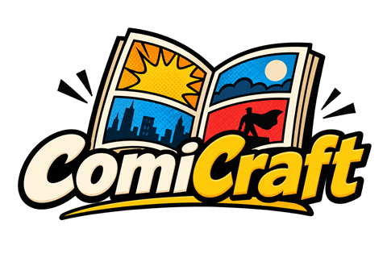

[](https://github.com/jeffnyman/comicraft/actions/workflows/build.yml)
[](https://www.nuget.org/packages/ComiCraft)

✨ *Long live the classics.*

**ComiCraft** is a comic book viewer written in C#. It reads CBZ (zip), CBR (RAR) and CB7 (7-Zip)
files, as well as PDFs made of page images, which is what most comic PDFs are. You can read a page at a
time, fit pages to the window's width, or zoom in and scroll around. If the comic has a
`ComicInfo.xml`, ComiCraft will show you what it says.

ComiCraft looks at what's inside a file rather than trusting its extension, so a CBR that's
really a zip (or vice versa) opens just fine. The pages are the images inside (JPEG, PNG, GIF,
WebP or BMP), sorted the way you'd expect, so `page2.jpg` comes before `page10.jpg`.

### PDFs

ComiCraft opens PDFs whose pages are each a single picture. That covers the PDFs ComiCraft
makes itself and most scanned comics. Rather than rendering the PDF the way a PDF reader would,
ComiCraft pulls each picture out as it is: a JPEG comes out as the very same JPEG, and anything
else as the same pixels. So the page looks exactly as it did in the comic it came from.

If a page isn't just a picture (say it has text set on it, or it's built from several images),
ComiCraft shows a note explaining why in place of that page. A PDF with no picture pages at all,
like an ordinary book of text, won't open. Hidden text behind a scan, the kind that makes it
searchable, doesn't count against it. If the PDF has a `ComicInfo.xml` attached (ComiCraft
attaches one to the PDFs it makes), that's where the comic's details come from.

## Installing

ComiCraft is a dotnet tool on nuget.org, and the library it's built on is a package of its own.
Both need .NET 10.

```
dotnet tool install -g ComiCraft
comicraft <comic or folder>
```

`dotnet tool update -g ComiCraft` gets you the newest version later on.

If you'd like to work with comics in your own code, `ComiCraft.Comics` reads CBZ, CBR, CB7 and
picture PDFs, reads and writes `ComicInfo.xml`, and converts comics to CBZ or PDF:

```
dotnet add package ComiCraft.Comics
```

```csharp
using ComiCraft.Comics;

var comic = ComicBook.Open("Troll 001.cbz");
Console.WriteLine($"{comic.Heading}: {comic.PageCount} pages");

// each page is the image as it is in the archive, a JPEG, PNG and so on
File.WriteAllBytes("cover" + Path.GetExtension(comic.PageNames[0]), comic.Page(0).ToArray());

// change one field of the comic's ComicInfo.xml, keeping everything else in it
var info = ComicArchive.ReadComicInfo("Troll 001.cbz") ?? ComicInfoDocument.New();
info.Set("Publisher", "Image");
ComicArchive.WriteComicInfo("Troll 001.cbz", info);
```

## Reading

`comicraft <comic>` opens a comic in a window shaped like its first page. If you've read it
before, it picks up where you left off (see [Where you were](https://github.com/jeffnyman/comicraft#where-you-were)).
`comicraft <folder>` shows you the comics in that folder so you can pick one (see
[The comics in a folder](https://github.com/jeffnyman/comicraft#the-comics-in-a-folder)). `comicraft --help` lists the keys.

| Option | What it does |
|---|---|
| `--fullscreen` | Opens full screen. |

### Fitting the page

Comic pages are taller than they are wide, and most screens are the opposite, so there are two
ways to fit a page, and you can zoom in beyond either one. **W** switches between them, and the
title bar shows when you're fitted to width and how far you've zoomed.

| Fit | What it does |
|---|---|
| Page | Shows the whole page at once, as large as it fits. Comics open this way. |
| Width | Fills the width of the window, and you scroll down through the page. Panels and lettering are as large as the window allows. |
| Zoomed | Shows the page as large as you like, from the whole page (100%) up to four screen pixels for every pixel of the page. You scroll across and down. |

**+** and **−** zoom in and out around the middle of the window. Ctrl with the mouse wheel, or a
pinch on a trackpad, zooms around the pointer and keeps whatever's under it in place. **0** takes
you back to the whole page. Your zoom carries over as you turn pages, since if you needed it on
one page you'll probably need it on the next.

### Reading a page larger than the window

You read a page the way you would in print: across, then down. Space moves a screen across the
page; when you reach the right edge, it jumps back to the left a screen further down; and at the
bottom, it goes on to the top left of the next page. Page Up does the same in reverse, back to
the end of the previous page. If the page is no wider than the window, there's nothing to go
across, so Space just goes down.

### Keys

| Key | What it does |
|---|---|
| Space, Page Down | Moves a screen across or down the page. At the end of a page, goes to the top of the next one. |
| Page Up | Moves a screen back across or up the page. At the start of a page, goes back to the end of the previous one. |
| Down, Up | Scrolls down or up a little. At the end of a page, goes on or back a page, as above. |
| Right | Scrolls right a little on a page wider than the window. At the right edge, or if the page fits, goes to the top of the next page. |
| Left | Scrolls left a little on a page wider than the window. At the left edge, or if the page fits, goes to the top of the previous page. |
| Backspace | Goes to the top of the previous page. |
| Home, End | Goes to the first or last page. |
| W | Switches between fitting the whole page and fitting the width. |
| +, − | Zooms in or out around the middle of the window. (= also zooms in, so you don't need Shift.) |
| 0 | Goes back to fitting the whole page. |
| I | Shows or hides the comic's details. |
| L, Tab | Shows or hides the comics in the folder. |
| F, F11 | Switches between windowed and full screen. |
| Escape | Hides the details if they're showing; otherwise quits. |
| Q | Quits. |

When you're seeing the whole page, there's nothing to scroll, so any key that moves forward or
back simply turns the page.

If you hold down a key that moves forward or back, it scrolls to the end of the page and stops
there. It only goes on to the next page when you press it again, so you never skip past pages
you haven't read. On a page wider than the window, Space and Page Up also stop at the end of each
row. When you're seeing the whole page, holding a key turns page after page.

### Mouse

| Action | What it does |
|---|---|
| Wheel, or two fingers on a trackpad | Scrolls a page larger than the window, across as well as down. It never turns the page. |
| Ctrl and the wheel, or a pinch on a trackpad | Zooms in or out around the pointer. |
| Drag | Moves a page larger than the window. |
| Click on the right half of the window | Goes forward, like Page Down. |
| Click on the left half of the window | Goes back, like Page Up. |
| Click with the details showing | Hides them. |

A click means pressing and releasing in the same spot. If you move the pointer more than a few
points with the button down, it counts as a drag, and letting go won't turn the page.

### The comic's details

**I** shows a panel over the page with everything known about the comic: its publisher and date,
who wrote and drew it, who appears in it, how many pages it has, and which file it came from. The
title bar heading comes from the same place, for example *Operation: Knightstrike #3 – Enter...
Bloodstrike (July 1995)*.

All of this comes from the comic's `ComicInfo.xml`, the metadata format that started with
ComicRack and is now maintained by the [Anansi Project](https://anansi-project.github.io/docs/comicinfo/intro).
Comics without one, or with one that can't be read, still open fine; you'll just see the file
name and the pages.

### The comics in a folder

**L** (or Tab) opens a panel down the left side of the window listing the comics in the same
folder as the one you're reading, so you can switch to another, much like the file list beside
the code in an editor. If you give `comicraft` a folder, it opens with this panel showing.

```
comicraft ~/Comics/Troll
```

The list starts with the parent folder, then any subfolders, then the comics (CBZ, CBR, CB7 and
PDF), each sorted the way you'd expect, so issue 2 comes before issue 10. Hidden files and
folders, and anything that isn't a comic, are left out. The comic you're reading is shown in
gold.

| Key or mouse | What it does |
|---|---|
| Down, Up | Selects the next or previous entry. |
| Page Down, Page Up, Home, End | Jumps a screen down or up, or to the first or last entry. |
| Enter, Right | Opens the selected comic, or goes into the selected folder. |
| Left, Backspace | Goes up to the parent folder. |
| Click | Opens the comic, or goes into the folder, you clicked. |
| Wheel | Scrolls the list. |
| Click outside the list | Hides it. |
| L, Tab, Escape | Hides it. If no comic is open, Escape quits. |

A comic you open from the list picks up where you left off, just as it would if you opened it by
name, and ComiCraft remembers your place in the one you were reading. The window stays the same
size, and the new comic is fitted to it. If a comic can't be opened, the reason appears at the
bottom of the list, and the one you were reading stays open.

### Where you were

Comics open where you left off: on the same page, with the same fit, zoom and scroll position.
Your place is saved every time you turn a page, when you close the window, and when you stop
ComiCraft with Ctrl+C. It's stored by each comic's full path, so if you move or rename a comic,
it'll open at the first page. ComiCraft remembers the last 1000 comics you've read, in a file of
your own:

| System | File |
|---|---|
| Windows | `%APPDATA%\ComiCraft\reading.json` |
| macOS | `~/Library/Application Support/ComiCraft/reading.json` |
| Linux | `$XDG_STATE_HOME/comicraft/reading.json`, which is `~/.local/state/comicraft/reading.json` unless you've set that variable |

Nothing else goes in that file, and nothing about your comics is stored anywhere else. You can
press **Home** at any time to go back to the first page. To make ComiCraft forget:

```
comicraft forget "Troll 001.cbz"    # forget one comic, so it opens at the first page again
comicraft forget --all              # forget every comic, removing the file
```

You can forget a comic even after it's been moved or deleted. Deleting the file yourself does
the same thing as `--all`, and if the file can't be read, ComiCraft treats it as empty and starts
over.

## Changing a comic's details

`comicraft tag <comic>` shows the fields in a comic's `ComicInfo.xml`. Give it some fields and it
changes them, then tells you what changed:

```
comicraft tag "Troll 001.cbz" --series Troll --number 1 --year 1993 --publisher Image
comicraft tag "Troll 001.cbz" --cover-artist "Rob Liefeld"
comicraft tag "Troll 001.cbz" --notes ""
```

Field names are the same as in ComicInfo, in any case and with or without hyphens
(`--coverartist`, `--cover-artist` and `--CoverArtist` all work). Both `--field=value` and
`--field value` are fine. An empty value (`""`) removes the field. `comicraft tag --help` lists
every field.

Every value is checked before anything is written, so a mistake (a month of 13, or a field that
doesn't exist) leaves the comic untouched. If nothing would actually change, the file isn't
written at all. Only the fields you give are changed. Everything else in `ComicInfo.xml` is kept,
including things ComiCraft doesn't use itself, like the page list or a tagging tool's own
elements. The pages are copied over unchanged, and the comic is replaced in a single step, so
it's never left half written. Read-only comics are left alone.

You can see a PDF's `ComicInfo.xml`, but not change it. To change it, edit the CBZ the PDF was
made from and make the PDF again.

### CBRs

A CBR is a RAR archive, and while free software can read RAR, it can't write it. So to change a
CBR, ComiCraft converts it to a CBZ alongside it, with everything the CBR had in it, and changes
that instead. It asks before converting (unless you pass `--convert`), and then asks whether to
move the original to the Trash. Anything other than yes means no. Even then, the original is only
removed once the new CBZ has been opened again and checked to have the same pages.

Where the original goes depends on your system:

- **macOS:** the Trash for the drive it's on, just as if you'd deleted it in Finder.
- **Linux:** the Trash laid out by the [freedesktop.org Trash Specification](https://specifications.freedesktop.org/trash/latest/),
  which GNOME, KDE and tools like `trash-cli` all understand. A file on the same file system as
  your home folder goes to the home trash (`~/.local/share/Trash`). A file on a different file
  system goes to that file system's own trash (`.Trash-<uid>` at its top), which includes Windows
  drives under `/mnt` in WSL.
- **Windows:** the Recycle Bin for the drive it's on, just as if you'd deleted it in Explorer.
  Windows quietly deletes a file for good when it can't recycle it (on a drive with no Recycle
  Bin, one set not to keep deleted files, or for a file too big for the Bin). So ComiCraft checks
  with Windows first and stops the delete if the file wouldn't actually be recycled.

On any system, if the Trash won't take the original, it's only deleted permanently if you say so.

### Looking comics up on Metron

Rather than typing every field yourself, you can have ComiCraft fill them in from
[Metron](https://metron.cloud), a free, community-run comic database:

```
comicraft tag "F:\Comics\Secret Wars I 01-12 (1984-1985)" --lookup --rename
```

ComiCraft works out which issue each comic is, from its `ComicInfo.xml` if that already has a
series and number, or otherwise from its file name (`Marvel Super-Heroes Secret Wars 01 (of 12)
(1984).cbr` is plenty). Comics from the same series are looked up together. ComiCraft shows you
the series Metron has that fit, you pick the right one, and then each comic is matched by its
issue number. Then you get the series, number, cover date, title, summary, credits, characters,
teams and more. Fields Metron has nothing for are left as they are, and so are your own notes.

`--rename` names each comic by what it says once it's been looked up. By default that's
`{year}{month} - {series} {number:00}`, which uses the cover date, so a folder sorts in
publication order: `198405 - Marvel Super Heroes Secret Wars 01.cbz`. You can give your own
pattern too, as in `--rename="{series} {number:000} ({year})"`. A pattern can use `{series}`,
`{number}`, `{title}`, `{year}`, `{month}`, `{day}`, `{volume}` and `{publisher}`, and `:00`
pads a number with zeros. Characters Windows won't allow in a file name are replaced, so
`Batman: Year One` becomes `Batman - Year One`. If you were partway through a comic, your place
moves with it to its new name.

Nothing is changed until you've seen everything that will be. ComiCraft lists each comic with
what it was found to be, its new name and the fields that change, and asks before going ahead;
`--dry-run` shows the list and stops there. CBRs are converted to CBZs, straight to their new
names, and you're asked once what to do with the originals. A name that's already taken is
never written over; the comic just keeps its name.

Metron needs a free account. Give ComiCraft your user name and password in the
`METRON_USERNAME` and `METRON_PASSWORD` environment variables (or an API token in
`METRON_TOKEN`). Metron limits how often it can be asked, and when it says to wait, ComiCraft
waits. Run from a script, ComiCraft only takes a series when exactly one matches the comics'
name and year; otherwise, `--series-id` tells it which one, using the id shown when you choose.
Metron shares its data under CC BY-SA 4.0, so ComiCraft notes in each comic's `Notes` field
where the information came from.

## Converting a comic

`comicraft convert <comic>` converts a comic to a CBZ without changing anything else, and
`comicraft convert <comic> --format pdf` converts it to a PDF. Either way, ComiCraft then asks
about the original, as described above, and only removes it once the new file has been read back
and found to have all the pages. `--to <file>` names the new file (a name ending in `.pdf` makes a
PDF, even without `--format`). An existing file is never overwritten.

Any PDF ComiCraft can open (see [PDFs](https://github.com/jeffnyman/comicraft#pdfs)) can also be converted to a CBZ. Each page goes in
as the exact picture it is, named for its position (`Page 001.jpg`, `Page 002.png`), along with
the PDF's attached `ComicInfo.xml`. A comic converted to a PDF and back has the same pages it
started with. A PDF with a page that isn't a picture won't be converted, since there's nothing
to put in that page's place. The PDF is only removed once the CBZ has been read back and found to
have the same pictures.

A PDF made by ComiCraft has one page for each of the comic's pages, in the same order, and each
page holds just that image. Nothing is lost along the way:

- JPEG and PNG pages go in exactly as they are, byte for byte, since a PDF can hold them directly.
- WebP, GIF and BMP pages, which a PDF can't hold directly, go in as their pixels, compressed
  without loss. So do the occasional PNGs and JPEGs a PDF can't hold. (A PNG with transparency
  keeps it.)
- Every page is 10¼ inches tall, the height of a printed comic, and as wide as its shape calls
  for. A regular page comes out about 6⅝ inches wide, as in print, and a two-page spread twice
  that, no matter how finely it was scanned.

The comic's `ComicInfo.xml` supplies the PDF's title (the heading you see in the title bar), its
author (the writers), its subject (the summary) and its keywords (the genres). The whole file
also goes in as an attachment, so nothing in it is lost. Anything else in the archive, like a
scanner's note, has no place in a PDF and is left out. When ComiCraft opens the PDF, you get the
same pages, byte for byte, and the same details.

Before the original is removed, the PDF is read back by [PdfPig](https://github.com/UglyToad/PdfPig),
a PDF reader that's independent of ComiCraft. It has to find the same number of pages, each with
one image whose data matches what was written.

### A folder of comics

Give `convert` a folder and it converts every comic in it: every CBR to a CBZ, or, with
`--format pdf`, every CBR and CBZ to a PDF, each one next to its original. Use `--from` to choose
which kinds to convert instead (`cbr`, `cbz` or `pdf`, or several, like `cbr,pdf`), so
`--from pdf` converts every PDF to a CBZ. PDFs are only converted when you ask, since the PDFs in
a folder aren't necessarily comics; one that isn't gets reported and left alone. `--recursive`
includes subfolders too, skipping hidden ones (such as a Trash folder) and links to folders.

```
comicraft convert ~/Comics/Troll
comicraft convert ~/Comics --format pdf --recursive
comicraft convert ~/Comics --from pdf --recursive
comicraft convert ~/Comics --from cbr,pdf
```

ComiCraft asks what to do with the originals once, before it starts, so you don't have to stay
and watch. Each original is still checked before it's removed, and one the Trash won't take is
kept without asking. A comic whose CBZ or PDF already exists is skipped. If a comic can't be
converted, it's reported and the rest carry on. Each comic is numbered as it's done (`[3/40]`),
and a summary at the end says how many were converted, skipped or failed. Ctrl+C stops after the
current comic finishes, and a second Ctrl+C stops right away. ComiCraft exits with 3 if any comic
couldn't be converted or the run was stopped, and with 0 otherwise.

| Option | What it does |
|---|---|
| `--convert` | Converts a CBR so it can be changed, without asking. (`tag`) |
| `--delete-original` | Moves the original to the Trash after converting, without asking. |
| `--keep-original` | Keeps the original after converting, without asking. |
| `--format cbz \| pdf` | What to convert to: a CBZ (the default) or a PDF. (`convert`) |
| `--to <file>` | Names the converted file, when converting a single comic. (`convert`) |
| `--from <kinds>` | Which kinds of comic in a folder to convert: `cbr`, `cbz` or `pdf`, or several, like `cbr,pdf`. (`convert`) |
| `--recursive` | Converts comics in subfolders too. (`convert`) |
| `--lookup` | Fills in a comic's details, or a folder's, from Metron. (`tag`) |
| `--rename[=<pattern>]` | Names each comic by its details once looked up. (`tag --lookup`) |
| `--series-id <id>` | Says which Metron series the comics are in, instead of choosing. (`tag --lookup`) |
| `--dry-run` | Shows what a lookup would change, and changes nothing. (`tag --lookup`) |

When run from a script with its input redirected, ComiCraft never asks anything: a CBR isn't
converted without `--convert`, an original is kept without `--delete-original`, and an original
the Trash won't take is kept.

## Layout

| Path | What it is |
|---|---|
| `src/ComiCraft.Comics` | The comic library: opening archives, finding and ordering pages, reading and editing `ComicInfo.xml`, writing and converting archives, converting comics to PDFs and reading PDFs as comics, and the details and text wrapping the viewer shows. |
| `src/ComiCraft.Viewer` | The `comicraft` command: the viewer, built on SDL (the window, fitting and scrolling pages, keys and mouse, and the details panel), the folder list (`Shelf`), the `tag`, `convert` and `forget` commands (`Cli`), remembering your place in each comic (`ReadingPlaces`), looking comics up on Metron and naming them (`Lookup`), and moving originals to the Trash (`Platform`). |
| `tests/ComiCraft.Comics.Tests` | Tests for the library, using small comics and images made in memory and on disk (CBRs included), PDFs it makes read back by PdfPig, and hand-made PDFs with both picture and non-picture pages. |
| `tests/ComiCraft.Viewer.Tests` | Tests for the viewer's layout and navigation, without a window, and for the commands. |
| `tools/icon` | Writes the viewer's icon, `comicraft.ico` and the `assets/icon.png` nuget.org shows, from `AppIcon`, the same drawing the window's icon comes from. |

Besides the .NET SDK, ComiCraft depends on [SharpCompress](https://github.com/adamhathcock/sharpcompress)
for archives, PdfPig for reading PDFs, and SDL3 (`ppy.SDL3-CS`), SDL3_image (`ppy.SDL3_image-CS`)
and SDL3_ttf (`ppy.SDL3_ttf-CS`) for the viewer's window, images and text.

The viewer's text is set in [Inter](https://rsms.me/inter/), by Rasmus Andersson, which is built
into the viewer. Inter is licensed under the SIL Open Font License 1.1, included in
`src/ComiCraft.Viewer/Fonts/OFL.txt` and copied alongside the viewer when it's built.

## Building and running

You'll need the .NET 10 SDK.

```
dotnet build ComiCraft.slnx
dotnet test ComiCraft.slnx
dotnet run --project src/ComiCraft.Viewer -- <comic> [--fullscreen]
dotnet run --project src/ComiCraft.Viewer -- tag <comic> [--<field> <value>...]
dotnet run --project src/ComiCraft.Viewer -- tag <comic | folder> --lookup [--rename] [--dry-run]
dotnet run --project src/ComiCraft.Viewer -- convert <comic | folder> [--format pdf] [--from pdf] [--recursive]
dotnet run --project src/ComiCraft.Viewer -- --help
```

`dotnet publish src/ComiCraft.Viewer -c Release -r win-x64` (or `linux-x64`, `osx-arm64` and so on)
makes the viewer a single file that needs nothing installed, not even .NET. Every push to `main`
builds one for Windows, Linux and macOS.

`dotnet run --project tools/icon -- src/ComiCraft.Viewer/comicraft.ico assets/icon.png preview.png`
writes the icon again after a change to `AppIcon`, with a sheet of every size to look at.

Comics never go in the repository: `*.cbz` and `*.cbr` are ignored.

## Author

Made with 🤍 by [Jeff Nyman](https://github.com/jeffnyman):
[website](https://testerstories.com), [LinkedIn](https://www.linkedin.com/in/jeffnyman/).

## Doxazein (δοξάζειν)

> חֶסֶד וֶאֱמֶת אַל־יַעַזְבֻךָ קָשְׁרֵם עַל־גַּרְגְּרֹתֶיךָ כָּתְבֵם עַל־לוּחַ לִבֶּךָ
>
> "Let not mercy and truth forsake thee:> bind them about thy neck;> write them upon the table of thine heart."
>
> *Proverbs 3:3*

## License

**ComiCraft**, A Viewer for Digital Comics. Copyright (C) 2026 [Jeff Nyman](https://github.com/jeffnyman).

This program is free software: you can redistribute it and/or modify it under the terms of the
[GNU General Public License](https://www.gnu.org/licenses/gpl-3.0.en.html) as published by the
Free Software Foundation, either version 3 of the License, or (at your option) any later version.
It is distributed in the hope that it will be useful, but WITHOUT ANY WARRANTY; without even the
implied warranty of MERCHANTABILITY or FITNESS FOR A PARTICULAR PURPOSE.

The Inter typeface built into the viewer is under the SIL Open Font License 1.1, in
`src/ComiCraft.Viewer/Fonts/OFL.txt`. Details a comic gets from [Metron](https://metron.cloud)
are Metron's, shared under CC BY-SA 4.0, and each comic's `Notes` says so. ComiCraft ships no
comics.
